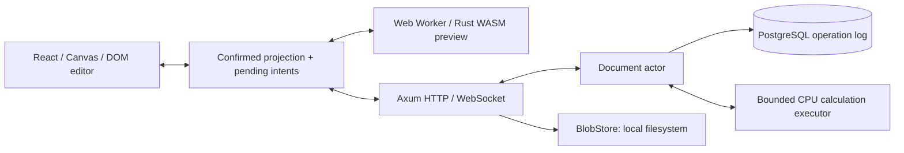

# Архитектура PXEL

Foundation: **ACCEPTED FOR PHASE 0**, 2026-09-28. Последующее поручение
продолжать все стадии записано в ADR-008; первый формульный профиль — в ADR-009.
Это разрешение на реализацию не заменяет отдельных gates формул и collaboration.
Документ описывает целевую архитектуру; фактическое состояние проверяется по RUNBOOK.

## Границы системы

MVP — modular monolith: один основной Axum binary, PostgreSQL как источник истины, локальное blob-хранилище. В фазе 5 появляется S3 adapter; в фазе 6 тот же binary может запускаться в изолированном режиме xlsx-worker. Redis, NATS, Kafka, микросервисы и distributed leader election не нужны.

Сервер определяет порядок, canonical operations и результаты формул. Клиент хранит confirmed projection отдельно от pending intents; WASM preview остается предварительным. Никакой ACK committed до durable COMMIT. Все публичные и сохраненные форматы versioned; неизвестная обязательная семантика отклоняется целиком.

Сейчас работают health/readiness, dev auth boundary, protobuf transport,
Canvas editing, durable CAS journal, bounded actor и filesystem BlobStore.
Формульное ядро/bound AST и отдельный WASM parity harness реализованы;
calculation executor и stateful preview worker приложения еще не подключены.

## Crates и направление зависимостей

| Crate                     | Владелец ответственности                                                    | Workspace dependencies                               | Вводится                            |
| ------------------------- | --------------------------------------------------------------------------- | ---------------------------------------------------- | ----------------------------------- |
| spreadsheet-domain        | IDs и общие domain values; позже workbook, чистые операции и normalized AST | Нет                                                  | 0, только используемые типы         |
| spreadsheet-application   | Используемые use cases/ports                                                | domain                                               | 0: BlobStore                        |
| spreadsheet-wire-protocol | Public protobuf DTO/codecs, без бизнес-модели                               | Нет                                                  | 0                                   |
| spreadsheet-storage       | PostgreSQL и LocalFilesystemBlobStore; позже S3 и event persistence         | domain, application; storage-codec с первого события | 0                                   |
| spreadsheet-storage-codec | Versioned durable protobuf envelope и его миграции при чтении               | domain при необходимости conversions                 | 1, когда сохраняется первое событие |
| spreadsheet-collab        | Actor, command validation/rebase, subscriptions, SessionDirectory           | domain, application; formula с фазы 2                | 1                                   |
| spreadsheet-formula       | Lexer/parser/binder/evaluator/graph/scheduler/locale/diagnostics            | domain                                               | 2                                   |
| spreadsheet-wasm          | Тонкий commands/patches adapter                                             | domain, formula, wire-protocol                       | 2                                   |
| spreadsheet-testkit       | Общие seeded generators, virtual clients, fault injection                   | Используемые domain/application/collab/formula       | При двух реальных потребителях      |
| spreadsheet-xlsx          | OOXML package reader/writer и отдельная normalized IR                       | domain, formula                                      | 6                                   |
| apps/server               | Composition root, transport/auth/runtime adapters                           | Только используемые crates                           | 0                                   |

`storage` никогда не импортирует `collab`; `collab` никогда не импортирует SQLx/storage types. OperationJournal, AuthorizationRepository, SnapshotRepository и CalculationExecutor вводятся в application только вместе с потребителями. Clock/IdGenerator не создаются ради каталогов интерфейсов. SessionDirectory вводится с actor по прямому требованию масштабирования.

Wire schemas находятся в `proto/pxel/wire/v1`; будущие durable schemas — отдельно в `proto/pxel/storage/v1`. Совпадение protobuf compiler не объединяет их release policy. Изменение WebSocket DTO не переписывает operation log. Transport↔domain и persisted↔domain conversions явные.

`domain::formula` временно может владеть небольшими versioned normalized AST types. Они не зависят от parser/evaluator и не содержат source spans. Diagnostic syntax AST — отдельный тип движка. Выделение formula-model возможно при доказанной необходимости; пустого crate сейчас нет.

## Документ и identity

Workbook хранит ordered SheetIds, sheets, date system, engine/profile settings. Sheet хранит оси, sparse cells, styles и document-level view settings. Имена и A1 — представление, не identity. Ключ ячейки: `(SheetId, StableRowId, StableColumnId)`.

Axis: `ordered_ids: Vec<StableAxisId>`, `positions: HashMap<StableAxisId,u32>`, `visible_extent: u32`. Только allocated extent имеет IDs. Начало 1000×26 создает 1026 axis IDs и ноль Cell records. При приближении редактора к краю UI запрашивает atomic ExtendRows с 1000 новыми IDs; extent растет без ручного UX действия. Аналогичная колонная операция вводится с необходимостью. Удаление содержимого не уменьшает extent. Deleted IDs не переиспользуются.

Content и style — разные свойства. ClearCell очищает content, style меняется отдельной командой. Formula хранит source text, canonical text, versioned bound AST; результат — derived cache. Row/column sizes — defaults плюс sparse overrides. Merge и named ranges хранят stable anchors; personal selection/scroll/presence не входят в durable projection.

Начальный нагрузочный профиль будущего редактора: до 100 000 заполненных ячеек, 100 000 rows, 1000 columns, 10 sheets, суммарно до миллиона allocated axis IDs. Это ограничение и объект benchmark, а не доказанная производительность.

## Durable flow и восстановление

Нормализовать command → авторизовать → дедуплицировать → rebase → подготовить candidate → проверить candidate/hash → CAS transaction → атомарно установить candidate → publish/ACK. SQL transaction повторяется целиком после конфликта вместе с определившей ее application logic. Подробности: [collaboration](collaboration.md), [persistence](persistence.md).

Snapshot не заменяет журнал. Cacheless content hash использует собственную canonical encoding; SHA-256 protobuf bytes проверяет только целостность этих байтов. Будущее восстановление: последний пригодный ACTIVE snapshot + последовательный log tail, либо предыдущий ACTIVE generation/full replay. Неизвестный event не пропускается.

CalculationCommitted существует отдельно от OperationCommitted. Сервер может объединять изменения и считать более новую версию, не публикуя промежуточный результат. Pure evaluator получает persisted context. Потеря calculation cache не является потерей authored state.

## Frontend

React отвечает за chrome, menus, formula bar, editor overlay и доступность. Canvas рисует viewport плюс overscan, учитывает DPR, планируется через requestAnimationFrame. Cells не лежат по отдельности в React state и не материализуются DOM-таблицей. Caret остается в DOM editor; static/dynamic Canvas layers вводятся только после benchmark.

Модули будущего редактора: viewport, size indexes, selection, input/keyboard controllers, clipboard, renderer, shared editing state machine, confirmed projection, pending queue, collaboration transport, calculation worker и bounded accessibility mirror. Phase 0 дает пустую сетку и handshake, без фиктивного сохранения/редактирования.

## Развертывание и рост

Первый deployment — один backend process; БД все равно защищает CAS от второго writer. Будущий SessionDirectory маршрутизирует документ к одному leader. Для нескольких writers требуется durable fencing token с lease и проверкой в commit; sticky sessions недостаточно. Никакой такой инфраструктуры сейчас не создается.

Нет обязательных внешних SaaS, remote fonts и включенной внешней телеметрии. Production размещение возможно в российском контуре. Development auth не входит в production build; native dependencies используют rustls, если выбранная интеграция не требует отдельно обоснованного исключения.

## Toolchain policy

Версии прежнего исследования — **candidate toolchain**, не tested baseline. Candidate pinned Rust 1.98.1/edition 2024; MSRV policy not established before production v1. Точные доступные версии и совместимость перепроверяются при bootstrap. Lock-файлы и pinned generators обязательны; major upgrades не автоматизируются.

Перед объявлением tested baseline нужны реальные native/WASM builds, SQLx/PostgreSQL checks, Rust↔TS protobuf round-trip, frontend typecheck/build и Playwright smoke в выбранном runtime. Отчет о недоступном candidate или изменении выбора фиксируется в RUNBOOK, не скрывается успешной установкой другой версии.
