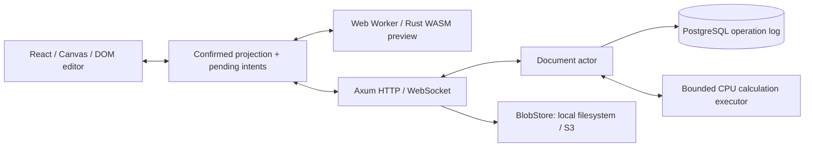

# Архитектура PXEL

Foundation: **ACCEPTED FOR PHASE 0**, 2026-09-28. Последующее поручение
продолжать все стадии записано в ADR-008; первый формульный профиль — в ADR-009.
Это разрешение на реализацию не заменяет отдельных gates формул и collaboration.
Документ описывает целевую архитектуру; фактическое состояние проверяется по RUNBOOK.

## Границы системы

MVP — modular monolith: один основной Axum binary, PostgreSQL как источник истины и переключаемый BlobStore (локальный filesystem или optional S3 feature). XLSX parsing выполняется в отдельном процессе с ограниченным framed protocol: operator CLI допускает native worker, а публичные preview/publication требуют pinned WASI runtime с guest/host limits (ADR-132—136). Windows execution проверен локально; Linux остаётся открытым gate. Redis, NATS, Kafka, микросервисы и distributed leader election не нужны.

Сервер определяет порядок, canonical operations и результаты формул. Клиент хранит confirmed projection отдельно от pending intents; WASM preview остается предварительным. Никакой ACK committed до durable COMMIT. Все публичные и сохраненные форматы versioned; неизвестная обязательная семантика отклоняется целиком.

ADR-130/131 keep XLSX package parsing outside the document actor. Optional
worker-protocol in spreadsheet-xlsx shares bounded stdin/IR framing between
the native child and standalone WASI executable; it depends only on ZIP/XML,
serde/JSON and typed errors, never domain/application/storage. The parent still
validates IR before constructing an authorized candidate. WASI guest-boundary
tests do not imply that backend sandbox integration or public upload is ready.

ADR-132 integrates an operator-pinned WASI runtime into CLI preview/import,
and ADR-134 adds candidate host kernel limits for configured execution and its
version probe. processkit3.3.4 is restricted to the server runtime adapter;
domain/application/formula/storage dependencies remain unchanged. Windows uses
a capped Job Object; Linux needs an enforceable cgroup v2 and remains unverified.
ADR-135 adds authenticated bounded public preview and browser sheet selection;
pending upload admission/cancellation are locally tested. Candidate/formula
compatibility and atomic browser publication are still open.

Сейчас работают health/readiness, dev auth boundary, protobuf transport,
Canvas editing, durable CAS journal, bounded actor, filesystem BlobStore и
optional S3 adapter. Moto 5.2.3 contract и server restart проверены;
production Garage/российский S3 ещё не проверены.
Формульное ядро/bound AST и native/browser parity harness реализованы.
Сервер использует bounded calculation executor, а приложение — stateful WASM
preview worker. Предварительные результаты остаются отдельно от серверного расчёта.
Перенос использует shared Rust planner внутри этого Worker: передаются stable-ID
геометрия и версии, возвращаются bounded content/calculation patches. Кандидат
и calculation cache публикуются локально только после успешного расчёта и
сериализации; confirmed content/hash никогда не меняются от preview (ADR084).

Structural history (ADR085) uses frozen axis edits and own compensations with
exact preimages. Revived stable IDs have durable activation floors, included in
the domain hash and snapshot writer4. Journal admission independently verifies projection
context and currentness after receipt lookup; no actor-only validation assumption
is sufficient. Integration verification is recorded in RUNBOOK.

[ADR-086](adr/086-durable-author-history.md) добавляет чтение общей истории автора
в документе после reload/reconnect. Storage проверяет ограниченный непрерывный
суффикс PostgreSQL log, application восстанавливает два стека из descriptors без
содержимого, HTTP adapter возвращает до 100 потенциальных целей в каждом стеке.
Новая таблица истории и новый persisted формат не вводятся. Текущий ACL проверяется
при чтении; выполнение Undo/Redo по-прежнему проходит собственные command guards.
Граница чтения — 10 001 запись с учётом цели и 64 MiB payload. Срез локально
проверен на PostgreSQL, HTTP/WebSocket, в браузере и при аварийных перезапусках.

[ADR-087](adr/087-cell-formatting.md) добавляет sparse оформление с 16 отдельными
свойствами. `Sheet` хранит содержимое и непустые стили в разных maps по stable
адресу. Guarded history работает на уровне свойства: изменение содержимого или
другого свойства стиля не мешает Undo, чужая запись того же свойства мешает даже
при равном значении. Стиль не добавляет dirty formula nodes и volatile epochs.
Локальные codec/PG/Worker/UI проверки пройдены; полная регрессия нового среза
и остающиеся MVP gates учитываются отдельно в RUNBOOK.

## Crates и направление зависимостей

| Crate                     | Владелец ответственности                                          | Workspace dependencies                               | Вводится                            |
| ------------------------- | ----------------------------------------------------------------- | ---------------------------------------------------- | ----------------------------------- |
| spreadsheet-domain        | IDs, Workbook, чистые операции, normalized AST и guarded history  | Нет                                                  | Используемые типы и pure invariants |
| spreadsheet-application   | Используемые use cases/ports                                      | domain                                               | 0: BlobStore                        |
| spreadsheet-wire-protocol | Public protobuf DTO/codecs и явные typed conversions              | domain; никогда storage-codec                        | 0                                   |
| spreadsheet-storage       | PostgreSQL, filesystem/S3 BlobStore и event persistence           | domain, application, storage-codec; optional AWS SDK | 0, S3 в фазе 5                      |
| spreadsheet-storage-codec | Versioned durable protobuf envelope и его миграции при чтении     | domain при необходимости conversions                 | 1, когда сохраняется первое событие |
| spreadsheet-collab        | Actor, command validation/rebase, subscriptions, SessionDirectory | domain, application; formula с фазы 2                | 1                                   |
| spreadsheet-formula       | Lexer/parser/binder/evaluator/graph/scheduler/locale/diagnostics  | domain                                               | 2                                   |
| spreadsheet-wasm          | Тонкий commands/patches adapter                                   | domain, formula, wire-protocol                       | 2                                   |
| spreadsheet-testkit       | Общие seeded generators, virtual clients, fault injection         | Используемые domain/application/collab/formula       | При двух реальных потребителях      |
| spreadsheet-xlsx          | Bounded OOXML reader и versioned scalar/style IR                  | Нет; только general-purpose ZIP/XML                  | 6                                   |
| apps/server               | Composition root, transport/auth/runtime adapters                 | Только используемые crates                           | 0                                   |

`storage` никогда не импортирует `collab`; `collab` никогда не импортирует SQLx/storage types. OperationJournal, AuthorizationRepository, SnapshotRepository и CalculationExecutor вводятся в application только вместе с потребителями. Clock/IdGenerator не создаются ради каталогов интерфейсов. SessionDirectory вводится с actor по прямому требованию масштабирования.

Wire schemas находятся в `proto/pxel/wire/v1`; durable schemas — отдельно в `proto/pxel/storage/v1`. Совпадение protobuf compiler не объединяет их release policy. Изменение WebSocket DTO не переписывает operation log. Transport↔domain и persisted↔domain conversions явные.

CSV download (ADR-129) reads one stable sheet from an exact confirmed version,
calculates bounded derived values separately and uses the existing audited
disclosure delivery lease/gate. CSV has independent format permission and audit
identity. Policy DTO2/capabilities DTO3/audit DTO2 and stored disclosure codec2
do not change workbook/wire/snapshot codecs. Old encrypted policy rows stay
codec1, retain their format rights and never implicitly gain CSV permission.

`domain::formula` временно может владеть небольшими versioned normalized AST types. Они не зависят от parser/evaluator и не содержат source spans. Diagnostic syntax AST — отдельный тип движка. Выделение formula-model возможно при доказанной необходимости; пустого crate сейчас нет.

## Документ и identity

Workbook хранит ordered SheetIds, sheets, date system, engine/profile settings. Sheet хранит оси, sparse cells, styles и document-level view settings. Имена и A1 — представление, не identity. Ключ ячейки: `(SheetId, StableRowId, StableColumnId)`.

Axis: `ordered_ids: Vec<StableAxisId>`, `positions: HashMap<StableAxisId,u32>`, `visible_extent: u32`. Только allocated extent имеет IDs. Начало 1000×26 создает 1026 axis IDs и ноль Cell records. При приближении редактора к краю UI запрашивает atomic ExtendRows с 1000 новыми IDs; extent растет без ручного UX действия. Аналогичная колонная операция вводится с необходимостью. Удаление содержимого не уменьшает extent. Новые оси не получают ранее удалённые IDs; guarded компенсация может восстановить исходный ID с durable activation floor (ADR-085).

Content и style — разные свойства. ClearCell очищает content, style меняется отдельной командой. Formula хранит source text, canonical text, versioned bound AST; результат — derived cache. Row/column sizes — defaults плюс sparse overrides. Merge range хранится по stable row/column IDs, входит в canonical hash и snapshot writer4; пересекающие merge structural edits и записи в covered non-anchor cells отклоняются. Поддержаны guarded merge/unmerge и ограниченный OOXML profile. Named ranges требуют отдельной реализации; personal selection/scroll/presence не входят в durable projection.

Начальный нагрузочный профиль будущего редактора: до 100 000 заполненных ячеек, 100 000 rows, 1000 columns, 10 sheets, суммарно до миллиона allocated axis IDs. Это ограничение и объект benchmark, а не доказанная производительность.

## Durable flow и восстановление

Нормализовать command → авторизовать → дедуплицировать → rebase → подготовить candidate → проверить candidate/hash → CAS transaction → атомарно установить candidate → publish/ACK. SQL transaction повторяется целиком после конфликта вместе с определившей ее application logic. Подробности: [collaboration](collaboration.md), [persistence](persistence.md).

Snapshot не заменяет журнал. Cacheless content hash использует собственную canonical encoding; SHA-256 protobuf bytes проверяет только целостность этих байтов. Будущее восстановление: последний пригодный ACTIVE snapshot + последовательный log tail, либо предыдущий ACTIVE generation/full replay. Неизвестный event не пропускается.

CalculationCommitted существует отдельно от OperationCommitted. Сервер может объединять изменения и считать более новую версию, не публикуя промежуточный результат. Для точной `base_input_version` он передаёт changed/cleared calculation delta; при cache miss, rebuild или несовпавшей версии отправляет полный snapshot. Все chunks проверяются и публикуются атомарно, только для текущих input version/context/epoch. Pure evaluator получает persisted context. Потеря calculation cache не является потерей authored state. См. [ADR-100](adr/adr-100-versioned-calculation-deltas.md).

## Frontend

React отвечает за chrome, menus, formula bar, editor overlay и доступность. Canvas рисует viewport плюс overscan, учитывает DPR, планируется через requestAnimationFrame. Cells не лежат по отдельности в React state и не материализуются DOM-таблицей. Caret остается в DOM editor; static/dynamic Canvas layers вводятся только после benchmark.

Модули будущего редактора: viewport, size indexes, selection, input/keyboard controllers, clipboard, renderer, shared editing state machine, confirmed projection, pending queue, collaboration transport, calculation worker и bounded accessibility mirror. Phase 0 дает пустую сетку и handshake, без фиктивного сохранения/редактирования.

Текущий клиент загружает Undo/Redo отдельно от confirmed projection и pending
intents. Пока история не согласована, её кнопки недоступны; ввод и отправка
изменений продолжают работать. Отдельная граница обработанных событий истории
не продвигается от одной лишь HTTP-загрузки projection. Пропуск версий в hint,
ACK или receipt требует discovery, даже если последнее событие чужое или
системное. Последовательные известные чужие/системные hints обходятся без полного
сканирования. Поздние ответы проверяются по document/actor/generation, а ACK,
уже включённый в загруженную историю, не добавляется повторно. Общая история
автора не воспроизводит приватный стек каждой вкладки.

Оформление проходит строгий typed projection decoder: authored projection schema 8,
style schema/profile 1. `confirmedStyles` и pending style overlay разделены;
неопределённый результат commit сохраняет исходные bytes/ID. Canvas рисует только
видимые оформленные ячейки, в том числе пустые; числовой формат меняет отображение,
но не значение в редакторе, clipboard или evaluator. Начальный профиль использует
Arial 10 pt, фиксированные цвета RGB и закрытые enum границ/выравнивания/форматов.
Шрифты не загружаются по URL. Copy/Move сохраняют прежнюю семантику переноса
содержимого; range copy/move переносят все sparse style leaves вместе с content
в одной durable batch и поддерживают guarded Undo/Redo (ADR-094/095).

Worker init 4 получает confirmed cells, sparse styles, retired IDs, activation
floors, last axis change marker и необязательный CalculationContext. Формула
передаётся с точным `bound_formula_wire_hex`; исходный A1 не связывается заново
относительно нынешних осей. Pending изменения поступают отдельным patch 2;
`null` сбрасывает свойство стиля. Output 2 содержит самостоятельно рассчитанный
authored state hash и отдельный calculated-result hash. Проверка серверного хэша
проводится только для совпадающей версии/revision без pending edits. Данные
protobuf формулы не используются как canonical encoding состояния.

Команды «Ячейки» (ADR-119) сохраняют настройки листа и видимость по stable IDs.
Hidden memberships удерживают retired IDs для структурного Undo; redacted
projection 2 передаёт только живые memberships. Authored projection 8 и worker
init 6 включают настройки для самостоятельного hash; snapshot 8 и event 39–42
имеют отдельные lifecycles. Копия листа получает новые IDs и локально переведённые
bound references. Настройки и копирование — history barriers, сдвиг ячеек —
guarded content/style batch с Undo/Redo. Автоподбор посылает существующий bounded
axis-size batch и сохраняет размеры скрытых осей и осей с объединениями.

## Развертывание и рост

Первый deployment — один backend process; БД все равно защищает CAS от второго writer. Будущий SessionDirectory маршрутизирует документ к одному leader. Для нескольких writers требуется durable fencing token с lease и проверкой в commit; sticky sessions недостаточно. Никакой такой инфраструктуры сейчас не создается.

Нет обязательных внешних SaaS, remote fonts и включенной внешней телеметрии. Production размещение возможно в российском контуре. Development auth не входит в production build; native dependencies используют rustls, если выбранная интеграция не требует отдельно обоснованного исключения.

## Toolchain policy

Версии прежнего исследования — **candidate toolchain**, не tested baseline. Candidate pinned Rust 1.98.1/edition 2024; MSRV policy not established before production v1. Точные доступные версии и совместимость перепроверяются при bootstrap. Lock-файлы и pinned generators обязательны; major upgrades не автоматизируются.

Перед объявлением tested baseline нужны реальные native/WASM builds, SQLx/PostgreSQL checks, Rust↔TS protobuf round-trip, frontend typecheck/build и Playwright smoke в выбранном runtime. Отчет о недоступном candidate или изменении выбора фиксируется в RUNBOOK, не скрывается успешной установкой другой версии.
